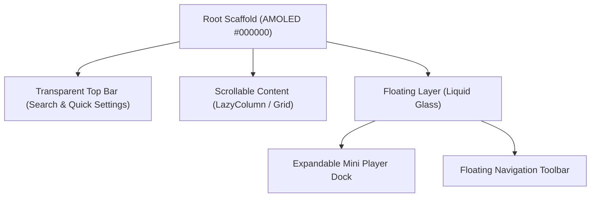

# Design Guidelines & Architecture

This document describes the visual identity, UI architecture, and design patterns implemented in **Neko Music**.

---

## Design Principles

### 1. Pure AMOLED First
The foundational canvas color is pitch black (`#000000`). This accomplishes two critical goals:
- **Maximum Power Efficiency**: Pixels on OLED/AMOLED displays are completely powered off, providing notable battery savings during long playback sessions.
- **Infinite Contrast**: Album artwork and dynamic accent glows pop vibrantly against an unlit backdrop.

### 2. Liquid Glass & Frosted Surfaces
Instead of opaque flat panels, secondary and floating layers utilize **liquid glass aesthetics**:
- Semi-transparent dark surfaces (`Color(0xCC1A1A1A)`) combined with subtle background blurs (`Modifier.blur`).
- Applied across bottom navigation capsules, bottom sheets, mini-player docks, and dialog overlays.

### 3. Real-Time Dynamic Color Adaptation
Colors adapt dynamically to the music currently playing:
- The active track's cover art is sampled at runtime to extract dominant, vibrant, and muted color swatches.
- These extracted hues dynamically tint the now-playing background glow, progress slider, volume controls, and active playback buttons.

### 4. Fluid Geometry & Squircles
- Rather than sharp standard rounded rectangles, prominent cards and dialogs utilize continuous-curvature squircles (`AbsoluteSmoothCornerShape`) with 60% smoothness parameters.
- Creates an organic, tactile aesthetic consistent with modern expressive mobile interfaces.

---

## Jetpack Compose Color System

Neko Music utilizes a custom Material 3 color scheme tuned for pitch-black AMOLED displays:

| Color Token | Default Hex | Compose Usage |
| :--- | :--- | :--- |
| `background` | `#000000` | Scaffold root background across all screens |
| `surface` | `#0C0C0C` | Slightly elevated container surfaces and cards |
| `surfaceVariant` | `#161616` | Sheet backgrounds, menu items, search bars |
| `surfaceContainerLow` | `#121212` | Nested dialog card containers |
| `primary` | `#1DB954` *(adaptive)* | Active playback controls, track progress, key actions |
| `onPrimary` | `#000000` | Icons and typography rendered on top of primary buttons |
| `onSurface` | `#FFFFFF` | Primary headers, track names, and prominent typography |
| `onSurfaceVariant` | `#A0A0A0` | Subtitles, artist names, secondary metadata, and timestamps |

---

## Typography

Typography is powered by Google Fonts loaded dynamically through Compose's `FontFamily`:
- **Display & Headlines**: Bold, modern sans-serif with tight letter-spacing for artist profiles and screen headers.
- **Body & Captions**: Highly legible weights optimized for varying ambient light levels.
- **Time Indicators**: Configured with monospaced tabular figures (`FontFeature("tnum")`) to eliminate layout jitter as seconds elapse during track playback.

---

## Key UI Components

### 1. Floating Navigation Toolbar
- Floating pill-shaped bar positioned above the bottom system inset.
- Features frosted glass transparency, smooth tab transitions, and an integrated quick-access microphone button for instant Shazam song recognition.

### 2. Expandable Mini Player
- Sits seamlessly above the navigation capsule when media is active.
- Displays album art, track title, artist name, and a quick play/pause button.
- Tapping or swiping upward triggers a smooth Shared Element transition into the full-screen player.

### 3. Full-Screen Now-Playing Experience
- **Looping Video Canvas**: For supported tracks, fetches and renders Apple Music or Canvas short looping video backgrounds (`AppleMusicCanvasProvider`).
- **Synchronized Lyrics**: Fluid, word-by-word and syllable-by-syllable synchronized lyrics display with auto-scroll and jump-to-timestamp capabilities.
- **Waveform & Scrubbing**: Interactive waveform scrub bar with precise seek feedback.

### 4. Interactive Home Screen Widgets
Neko Music ships with multiple home screen widget styles designed in Jetpack Glance:
- **Modern Flow (4x2)**: Full media controls, cover art, and progress indicator.
- **Vintage Vinyl Turntable (4x2 / 2x2)**: Nostalgic animated turntable aesthetic.
- **Compact Glow (2x2)**: Minimalist square widget with artwork-tinted halo glow.
- **Slim Pill Strip (4x1)**: Low-profile single-row playback controls.
- **Music Recognizer Widget**: One-tap quick audio fingerprinting from the home screen.
