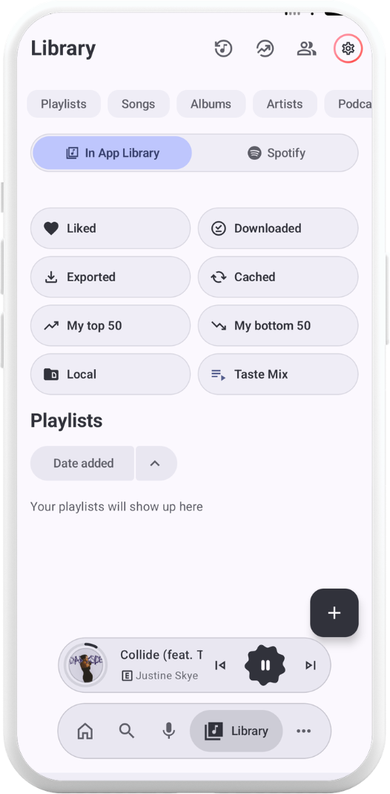

  
  
<b>A modern, ad-free Android music streaming client built natively with Kotlin and Jetpack Compose.</b>

  
  
  
  
  

---

## Overview

**Neko Music** is an ad-free, open-source Android music streaming client engineered for audiophiles, enthusiasts, and users who value privacy and design.

Operating directly with YouTube Music via the InnerTube API, Neko Music provides uninterrupted, high-fidelity audio streaming without advertisements, proprietary tracking, or background telemetry. The app features native Bit-Perfect USB DAC audio output, multi-source synchronized lyrics, a responsive parametric equalizer, and an immersive Material 3 user interface with full AMOLED dark mode.

---

## Direct Download

  
  &nbsp;&nbsp;
  
  &nbsp;&nbsp;
  

> 💡 **Which one should you download?**
>
> - **ARM64 APK** *(Recommended, ~30 MB)*: Optimized for all modern 64-bit Android phones and tablets (e.g., Samsung Galaxy S/A series, Google Pixel, Xiaomi, OnePlus, Nothing Phone). Smaller download size with native 64-bit performance.
> - **Universal APK** *(~59 MB)*: Works on **any** Android device (ARM64, ARMv7, x86, x86_64), including older smartphones, emulators, and Android TV boxes. Choose this if you are unsure which processor your device uses!

---

## Table of Contents

- [Overview](#overview)
- [Direct Download](#direct-download)
- [Screenshots](#screenshots)
- [Features](#features)
- [Audio Extensions](#audio-extensions)
- [Download & Installation](#download--installation)
- [Architecture](#architecture)
- [Documentation](#documentation)
- [Contributors](#contributors)
- [Developer & Support](#developer--support)
- [License & Credits](#license--credits)
- [Disclaimer](#disclaimer)

---

## Screenshots

  <table style="margin: 0 auto; border-collapse: collapse;">
    <tr>
      <td align="center" style="padding: 15px; border: none;">
        <b>Home Screen</b>  
        
      </td>
      <td align="center" style="padding: 15px; border: none;">
        <b>Search &amp; Explore</b>  
        
      </td>
      <td align="center" style="padding: 15px; border: none;">
        <b>Music Library</b>  
        
      </td>
    </tr>
    <tr>
      <td align="center" style="padding: 15px; border: none;">
        <b>Material Player</b>  
        
      </td>
      <td align="center" style="padding: 15px; border: none;">
        <b>Synchronized Lyrics</b>  
        
      </td>
      <td align="center" style="padding: 15px; border: none;">
        <b>Apple Style Player</b>  
        
      </td>
    </tr>
  </table>

---

## Features

<b>Streaming &amp; Playback</b>

 

- **Ad-Free Streaming** — Direct audio streaming from YouTube Music without advertisements or sponsored interruptions.
- **Background Playback** — Continuous playback with screen off or while multitasking using AndroidX Media3 ExoPlayer.
- **Offline Mode &amp; Caching** — Download songs, albums, and playlists for offline playback via the built-in download manager.
- **Gapless Playback &amp; Crossfade** — Configurable crossfade durations and gapless audio track transitions.
- **Audio &amp; Video Mode Switching** — Toggle seamlessly between audio-only streams and companion video playback.
- **Smart Queue Management** — Dynamic queue insertion, playlist mixing, and persistent queue state across app launches.

<b>Audio Engine &amp; DSP</b>

 

- **Bit-Perfect USB DAC Output** — Native C++ JNI bridge and USB Host audio driver (`:usbaudio`) that bypasses the standard Android OS 48 kHz audio resampler for bit-perfect output.
- **Parametric Equalizer** — 10-band equalizer with fine-grained frequency, gain, and bandwidth control (`:audio-dsp`, `:dsp-core`).
- **Audio DSP Processing** — Integrated bass boost, virtualizer, and loudness normalization.
- **Bluetooth Telemetry &amp; Codec Badging** — Real-time audio pipeline badges for active codecs, bit depth, and sample rates.

<b>Lyrics &amp; Visuals</b>

 

- **Multi-Source Synced Lyrics** — Fallback aggregation across LRCLIB, KuGou, BetterLyrics, SimpMusic, YouLyPlus, and Unison.
- **Syllable-Level Synchronization** — Word-by-word synchronized lyric rendering.
- **AI Lyrics Translation** — In-app translation for foreign language lyrics using user-provided API keys (OpenRouter, DeepL, or Mistral AI).
- **Animated Video Canvas** — Looping canvas video support for compatible tracks via Apple Music Canvas integration.
- **Song Recognition** — On-device audio recognition powered by ShazamKit (`:shazamkit`).

<b>User Interface &amp; Customization</b>

 

- **True AMOLED Dark Mode** — Pitch-black surfaces (`#000000`) optimized for battery efficiency on OLED displays.
- **Liquid Glass Aesthetic** — Modern glassmorphism, customizable blur backdrops, and squircle corner geometry.
- **Dynamic Monet Theming** — Theme accent colors adapt dynamically to current track album artwork.
- **Glance Home Screen Widgets** — Multiple widget styles including Modern Flow, Vinyl Turntable, Compact Glow, and Music Recognizer.
- **Customizable Layouts** — Adjustable player styles (Material 3 and Apple-inspired), thumbnail visibility, and UI density.

<b>Integrations &amp; Media Management</b>

 

- **Spotify Playlist Mirroring** — Connect Spotify to browse and import public and private playlists directly into Neko Music.
- **Listen Together** — Synchronized real-time playback sessions with friends over WebSockets.
- **Last.fm Scrobbling** — Automatic track scrobbling and now-playing status updates.
- **Discord Rich Presence** — Displays currently playing track, artist, and playback progress on Discord.
- **Local Audio Indexing** — Scan, index, and organize local device music alongside streaming catalogs.

---

## Audio Extensions

Neko Music includes native client support for self-hosted audio extension servers, enabling higher-fidelity playback streams:

- **320 kbps Audio Extension**: Streams high-bitrate 320 kbps MP3/AAC audio before falling back to YouTube Music.
- **Lossless Audio Extension**: Streams studio-master lossless FLAC and ALAC audio (up to 24-bit / 192 kHz) with direct bit-perfect DAC pass-through.

### How to Configure an Extension Server:
1. Open Neko Music and navigate to **Settings** &rarr; **Extensions**.
2. Tap **Add Custom Server**, specify a name, and enter your deployed server URL.
3. Toggle **Prefer Extension Audio** to **ON** to prioritize extension audio sources over standard streaming.

---

## Download & Installation

### Pre-compiled Releases
Pre-built APKs for supported architectures are available via direct download below or on the **[Releases](https://github.com/PurveshShinde/Neko-Music/releases/latest)** page:

| Package | Direct Download | Target Architecture | Size |
| :--- | :--- | :--- | :--- |
| **Universal APK** | [**Download Universal APK**](https://github.com/PurveshShinde/Neko-Music/releases/latest/download/nekomusic-v0.0.5-universal.apk) | All Android devices (ARM64, ARMv7, x86, x86_64) | ~59 MB |
| **ARM64 APK** | [**Download ARM64 APK**](https://github.com/PurveshShinde/Neko-Music/releases/latest/download/nekomusic-v0.0.5-arm64.apk) | Modern 64-bit devices (recommended) | ~30 MB |

> 💡 **Tip:** For prerequisites, SDK/NDK configuration, signing keys, and step-by-step building from source, refer to **[SETUP.md](SETUP.md)**. For contribution guidelines and pull requests, see **[CONTRIBUTING.md](CONTRIBUTING.md)**.

---

## Architecture

Neko Music is built on a clean, modular multi-project Gradle architecture:

| Module | Description |
| :--- | :--- |
| **`:app`** | Main entry point, Jetpack Compose UI screens, ViewModels, navigation, and dependency injection |
| **`:core`** | Room SQLite database (`InternalDatabase`), schema migrations, DataStore, and shared utilities |
| **`:domain`** | Pure Kotlin domain models, business logic interfaces, and contracts |
| **`:playback`** | Media3 ExoPlayer service (`MusicService`), notification management, queue control, and downloads |
| **`:innertube`** | YouTube Music InnerTube client (stream resolution, search, playlists, albums, and artist info) |
| **`:lyrics`** | Synchronized lyrics engine with fallback chain across 6+ providers and AI translation |
| **`:usbaudio`** | Native C++ JNI bridge and USB Host driver for Bit-Perfect DAC output |
| **`:audio-dsp`** | Equalizer engine, parametric EQ, and digital signal processing (`:dsp-core`) |
| **`:shazamkit`** | Audio fingerprinting and song recognition via Shazam API |
| **`:canvas`** / **`:applecanvas`** | Animated video canvas playback engine and providers |
| **`:metadata`** | Metadata enrichment from Spotify, MusicBrainz, and Last.fm |

---

## Documentation

| Document | Purpose |
| :--- | :--- |
| **[SETUP.md](SETUP.md)** | Environment setup, SDK/NDK configuration, signing keys, and build instructions |
| **[DESIGN.md](DESIGN.md)** | Jetpack Compose guidelines, Material 3 theming tokens, and Liquid Glass specs |
| **[CONTRIBUTING.md](CONTRIBUTING.md)** | Contribution standards, code style, git workflow, and pull request procedures |
| **[CREDITS.md](CREDITS.md)** | Upstream lineage, copyright notices, and third-party dependency licenses |
| **[PRIVACY_POLICY.md](PRIVACY_POLICY.md)** | Privacy guarantees, zero-telemetry commitment, and permissions policy |
| **[SECURITY.md](SECURITY.md)** | Security vulnerability reporting guidelines |
| **[CHANGELOG.md](CHANGELOG.md)** | Release notes and version history |
| **[LICENSE](LICENSE)** | GNU General Public License v3.0 text |

---

## Contributors

<!-- readme: contributors -start -->
<table>
<tr><td align="center"></td></tr>
</table>
<!-- readme: contributors -end -->

---

## Developer & Support

### **[Purvesh Shinde](https://github.com/PurveshShinde)**
*Lead Developer & Maintainer*

  <a href="https://purveshshinde.vercel.app">Portfolio</a> • 
  <a href="https://github.com/PurveshShinde">GitHub</a>

 

---

## License & Credits

Neko Music is free and open-source software created and maintained by **[Purvesh Shinde](https://github.com/PurveshShinde)** and licensed under the **[GNU General Public License v3.0](LICENSE)**.

The project is derived from **[Echo Music](https://github.com/EchoMusicApp/Echo-Music)** by Aditya ([@iad1tya](https://github.com/iad1tya)) and contributors, building upon foundational open-source work from **[InnerTune](https://github.com/z-huang/InnerTune)** and **[ViMusic](https://github.com/vfsfitvnm/ViMusic)**.

For full copyright notices, upstream lineage details, component contributors (including Spotify integration and Lossless extensions), and third-party dependency licenses, please refer to **[CREDITS.md](CREDITS.md)**.

---

## Disclaimer

Neko Music is a free, open-source client developed strictly for personal, non-commercial, and educational use under the GNU General Public License v3.0. It does not host, store, cache on remote servers, or distribute copyrighted media files. All streams originate directly from YouTube's public infrastructure. Users are encouraged to support creators through official services and subscriptions such as [YouTube Premium](https://www.youtube.com/premium). For comprehensive data handling, privacy guarantees, and permissions, please review **[PRIVACY_POLICY.md](PRIVACY_POLICY.md)**.
