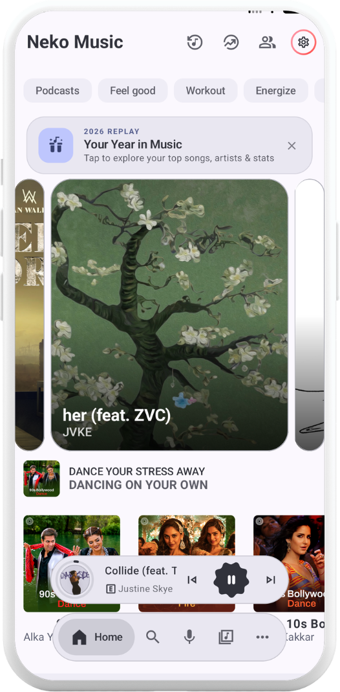
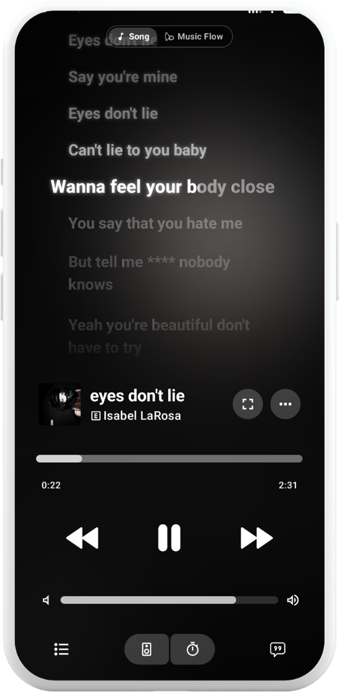

<div align="center">
  
  <p><b>A modern, ad-free Android music streaming client built natively with Kotlin and Jetpack Compose.</b></p>
</div>

<p align="center">
  <a href="https://kotlinlang.org"></a>
  <a href="https://developer.android.com/jetpack/compose"></a>
  <a href="https://developer.android.com/media/media3"></a>
  <a href="LICENSE"></a>
</p>

---

## Overview

**Neko Music** is an ad-free, open-source Android music streaming client engineered for audiophiles, enthusiasts, and users who value privacy and design.

Operating directly with YouTube Music via the InnerTube API, Neko Music provides uninterrupted, high-fidelity audio streaming without advertisements, proprietary tracking, or background telemetry. The app features native Bit-Perfect USB DAC audio output, multi-source synchronized lyrics, a responsive parametric equalizer, and an immersive Material 3 user interface with full AMOLED dark mode.

---

## Table of Contents

- [Overview](#overview)
- [Screenshots](#screenshots)
- [Features](#features)
- [Audio Extensions](#audio-extensions)
- [Installation & Setup](#installation--setup)
- [Architecture](#architecture)
- [Documentation](#documentation)
- [Contributors](#contributors)
- [Lineage & Special Thanks](#lineage--special-thanks)
- [Legal Disclaimer & Terms of Use](#legal-disclaimer--terms-of-use)
- [Developer & Contact](#developer--contact)
- [License](#license)

---

## Screenshots

<div align="left">
  <table style="margin: 0 auto; border-collapse: collapse;">
    <tr>
      <td align="center" style="padding: 15px; border: none;">
        <b>Home Screen</b><br><br>
        
      </td>
      <td align="center" style="padding: 15px; border: none;">
        <b>Material Player</b><br><br>
        
      </td>
      <td align="center" style="padding: 15px; border: none;">
        <b>Apple Style Player</b><br><br>
        
      </td>
    </tr>
    <tr>
      <td align="center" style="padding: 15px; border: none;">
        <b>Synchronized Lyrics</b><br><br>
        
      </td>
      <td align="center" style="padding: 15px; border: none;">
        <b>Search &amp; Explore</b><br><br>
        
      </td>
      <td align="center" style="padding: 15px; border: none;">
        <b>Music Library</b><br><br>
        
      </td>
    </tr>
  </table>
</div>

---

## Features

<details>
<summary><b>Streaming &amp; Playback</b></summary>
<br>

- **Ad-Free Streaming** — Direct audio streaming from YouTube Music without advertisements or sponsored interruptions.
- **Background Playback** — Continuous playback with screen off or while multitasking using AndroidX Media3 ExoPlayer.
- **Offline Mode &amp; Caching** — Download songs, albums, and playlists for offline playback via the built-in download manager.
- **Gapless Playback &amp; Crossfade** — Configurable crossfade durations and gapless audio track transitions.
- **Audio &amp; Video Mode Switching** — Toggle seamlessly between audio-only streams and companion video playback.
- **Smart Queue Management** — Dynamic queue insertion, playlist mixing, and persistent queue state across app launches.
</details>

<details>
<summary><b>Audio Engine &amp; DSP</b></summary>
<br>

- **Bit-Perfect USB DAC Output** — Native C++ JNI bridge and USB Host audio driver (`:usbaudio`) that bypasses the standard Android OS 48 kHz audio resampler for bit-perfect output.
- **Parametric Equalizer** — 10-band equalizer with fine-grained frequency, gain, and bandwidth control (`:audio-dsp`, `:dsp-core`).
- **Audio DSP Processing** — Integrated bass boost, virtualizer, and loudness normalization.
- **Bluetooth Telemetry &amp; Codec Badging** — Real-time audio pipeline badges for active codecs, bit depth, and sample rates.
</details>

<details>
<summary><b>Lyrics &amp; Visuals</b></summary>
<br>

- **Multi-Source Synced Lyrics** — Fallback aggregation across LRCLIB, KuGou, BetterLyrics, SimpMusic, YouLyPlus, and Unison.
- **Syllable-Level Synchronization** — Word-by-word synchronized lyric rendering.
- **AI Lyrics Translation** — In-app translation for foreign language lyrics using user-provided API keys (OpenRouter, DeepL, or Mistral AI).
- **Animated Video Canvas** — Looping canvas video support for compatible tracks via Apple Music Canvas integration.
- **Song Recognition** — On-device audio recognition powered by ShazamKit (`:shazamkit`).
</details>

<details>
<summary><b>User Interface &amp; Customization</b></summary>
<br>

- **True AMOLED Dark Mode** — Pitch-black surfaces (`#000000`) optimized for battery efficiency on OLED displays.
- **Liquid Glass Aesthetic** — Modern glassmorphism, customizable blur backdrops, and squircle corner geometry.
- **Dynamic Monet Theming** — Theme accent colors adapt dynamically to current track album artwork.
- **Glance Home Screen Widgets** — Multiple widget styles including Modern Flow, Vinyl Turntable, Compact Glow, and Music Recognizer.
- **Customizable Layouts** — Adjustable player styles (Material 3 and Apple-inspired), thumbnail visibility, and UI density.
</details>

<details>
<summary><b>Integrations &amp; Media Management</b></summary>
<br>

- **Spotify Playlist Mirroring** — Connect Spotify to browse and import public and private playlists directly into Neko Music.
- **Listen Together** — Synchronized real-time playback sessions with friends over WebSockets.
- **Last.fm Scrobbling** — Automatic track scrobbling and now-playing status updates.
- **Discord Rich Presence** — Displays currently playing track, artist, and playback progress on Discord.
- **Local Audio Indexing** — Scan, index, and organize local device music alongside streaming catalogs.
</details>

---

## Audio Extensions

Neko Music includes native client support for self-hosted audio extension servers, enabling higher-fidelity playback streams:

- **320 kbps Audio Extension**: Streams high-bitrate 320 kbps MP3/AAC audio before falling back to YouTube Music.
- **Lossless Audio Extension**: Streams studio-master lossless FLAC and ALAC audio (up to 24-bit / 192 kHz) with direct bit-perfect DAC pass-through.

### How to Configure an Extension Server:
1. Open Neko Music and navigate to **Settings** &rarr; **Extensions**.
2. Tap **Add Custom Server**, specify a name, and enter your deployed server URL.
3. Toggle **Prefer Extension Audio** to **ON** to prioritize extension audio sources over standard streaming.

---

## Installation & Setup

### Pre-compiled Releases
Pre-built APKs for supported architectures (ARM64 and Universal) are available on the **[Releases](https://github.com/PurveshShinde/Neko-Music/releases)** page.

### Building from Source
For complete prerequisites (Android Studio, JDK 21, Android SDK/NDK), release signing instructions, flavor options (`foss` vs `gms`), and build commands, refer to **[SETUP.md](SETUP.md)**.

```bash
# Clone the repository
git clone https://github.com/PurveshShinde/Neko-Music.git
cd Neko-Music

# Build FOSS Debug APK (100% open-source variant)
./gradlew assembleArm64FossDebug
```

---

## Architecture

Neko Music is built on a clean, modular multi-project Gradle architecture:

| Module | Description |
| :--- | :--- |
| **`:app`** | Main entry point, Jetpack Compose UI screens, ViewModels, navigation, and dependency injection |
| **`:core`** | Room SQLite database (`InternalDatabase`), schema migrations, DataStore, and shared utilities |
| **`:domain`** | Pure Kotlin domain models, business logic interfaces, and contracts |
| **`:playback`** | Media3 ExoPlayer service (`MusicService`), notification management, queue control, and downloads |
| **`:innertube`** | YouTube Music InnerTube client (stream resolution, search, playlists, albums, and artist info) |
| **`:lyrics`** | Synchronized lyrics engine with fallback chain across 6+ providers and AI translation |
| **`:usbaudio`** | Native C++ JNI bridge and USB Host driver for Bit-Perfect DAC output |
| **`:audio-dsp`** | Equalizer engine, parametric EQ, and digital signal processing (`:dsp-core`) |
| **`:shazamkit`** | Audio fingerprinting and song recognition via Shazam API |
| **`:canvas`** / **`:applecanvas`** | Animated video canvas playback engine and providers |
| **`:metadata`** | Metadata enrichment from Spotify, MusicBrainz, and Last.fm |

---

## Documentation

| Document | Purpose |
| :--- | :--- |
| **[SETUP.md](SETUP.md)** | Environment setup, SDK/NDK configuration, signing keys, and build instructions |
| **[DESIGN.md](DESIGN.md)** | Jetpack Compose guidelines, Material 3 theming tokens, and Liquid Glass specs |
| **[CONTRIBUTING.md](CONTRIBUTING.md)** | Contribution standards, code style, git workflow, and pull request procedures |
| **[CREDITS.md](CREDITS.md)** | Upstream lineage, copyright notices, and third-party dependency licenses |
| **[PRIVACY_POLICY.md](PRIVACY_POLICY.md)** | Privacy guarantees, zero-telemetry commitment, and local storage policy |
| **[SECURITY.md](SECURITY.md)** | Security vulnerability reporting guidelines |
| **[CHANGELOG.md](CHANGELOG.md)** | Release notes and version history |
| **[LICENSE](LICENSE)** | GNU General Public License v3.0 text |

---

## Contributors

<!-- readme: contributors -start -->
<table>
<tr><td align="center"><a href="https://github.com/PurveshShinde"></a></td></tr>
</table>
<!-- readme: contributors -end -->

---

## Lineage & Special Thanks

Neko Music is built upon the dedication and innovation of the open-source Android music community:

- **Echo Music** ([EchoMusicApp/Echo-Music](https://github.com/EchoMusicApp/Echo-Music)): Immediate upstream project by Aditya ([@iad1tya](https://github.com/iad1tya)) and contributors (GPL-3.0).
- **InnerTune** ([z-huang/InnerTune](https://github.com/z-huang/InnerTune)): Foundational architecture and InnerTube client by Zion Huang (GPL-3.0).
- **ViMusic** ([vfsfitvnm/ViMusic](https://github.com/vfsfitvnm/ViMusic)): Pioneer open-source YouTube Music client by vfsfitvnm (GPL-3.0).
- **Spotify Integration**: Reverse-engineered Spotify authentication by Chartreux Westia (`© Chartreux Westia — github.com/koiverse`, GPL-3.0).
- **Lossless Extension**: Audio addon provider by Silly Kat ([EchoMusicApp/lossless-extension](https://github.com/EchoMusicApp/lossless-extension), GPL-3.0).
- **Metrolist**: Glance widgets, ListenTogether concepts, and audio playback utilities (GPL-3.0).
- **Vendored Components**: `Kyant0/backdrop` (Apache 2.0) and `elyesmansour/compose-floating-tab-bar` (Apache 2.0).

For detailed copyright records and third-party notices, refer to **[CREDITS.md](CREDITS.md)**.

---

## Legal Disclaimer & Terms of Use

### 1. 100% Free, Open-Source & Strictly Non-Commercial
Neko Music is a free, open-source project (FOSS) developed for educational purposes and personal use under the GNU General Public License v3.0. There are no paid features, advertisements, tracking, subscriptions, or monetization mechanisms of any kind. This project has no commercial intent.

### 2. Custom Client with Content Filtering
Neko Music operates strictly as a specialized, third-party client interface. It parses publicly accessible endpoints and APIs of YouTube and YouTube Music, rendering them within a custom Android user interface. The ad-free streaming functionality is functionally equivalent to viewing public content via a browser with standard content filtering enabled.

### 3. Support Content Creators
We encourage all users to support the artists and creators whose music they enjoy by subscribing to [YouTube Premium](https://www.youtube.com/premium) and purchasing official merchandise, concert tickets, and media.

### 4. No Hosting of Copyrighted Material
Neko Music does not host, store, cache on remote servers, or distribute any audio, video, or copyrighted media files. All streamed media originates directly from YouTube's public infrastructure. The application serves solely as an audio stream player.

### 5. User Responsibility & Contact
The software is provided "AS IS", without warranty of any kind. Users are responsible for ensuring that their use complies with their local laws and the applicable terms of service. For questions or technical inquiries regarding the open-source codebase, please open an issue in the [GitHub Repository](https://github.com/PurveshShinde/Neko-Music/issues).

---

## Developer & Contact

- **Developer:** [Purvesh Shinde](https://github.com/PurveshShinde)
- **Website:** [purveshshinde.vercel.app](https://purveshshinde.vercel.app/)
- **Repository:** [https://github.com/PurveshShinde/Neko-Music](https://github.com/PurveshShinde/Neko-Music)

---

## License

Neko Music is licensed under the **GNU General Public License v3.0** ([GPL-3.0](LICENSE)).

```
Neko Music — An ad-free open-source music streaming client for Android.
Copyright (C) 2026 Purvesh Shinde and Neko Music Contributors.
Copyright (C) Echo Music, InnerTune, ViMusic, and Upstream Contributors.

This program is free software: you can redistribute it and/or modify
it under the terms of the GNU General Public License as published by
the Free Software Foundation, either version 3 of the License, or
(at your option) any later version.
```
