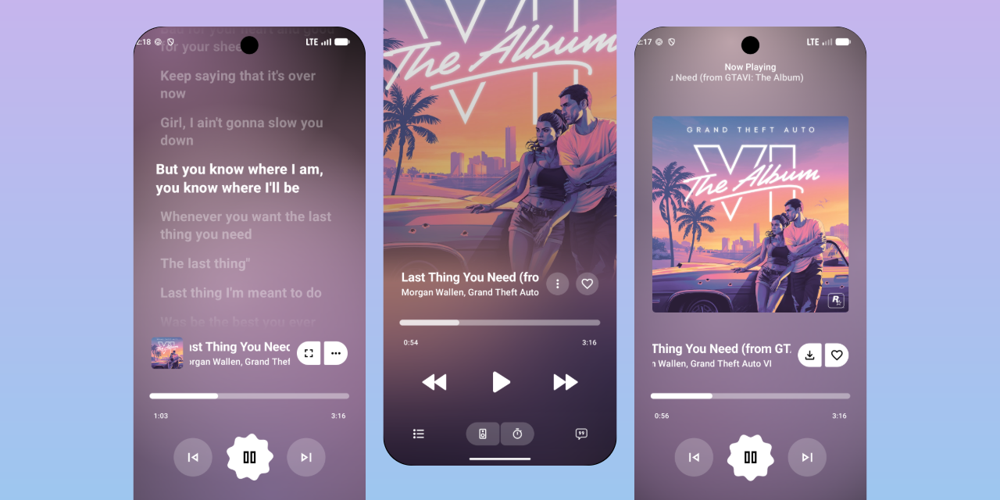
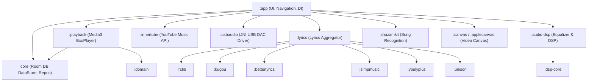

<p align="center">
  
</p>

<h1 align="center">Neko Music</h1>

<p align="center">
  A sleek, ad-free, open-source music streaming client for Android.<br>
  Built natively with <b>Kotlin</b> and <b>Jetpack Compose</b>, featuring audiophile Bit-Perfect USB DAC output, multi-source synced lyrics, and an immersive AMOLED design.
</p>

<p align="center">
  <a href="https://kotlinlang.org"></a>
  <a href="https://developer.android.com/jetpack/compose"></a>
  <a href="https://developer.android.com/media/media3"></a>
  <a href="LICENSE"></a>
</p>

<p align="center">
  <a href="#features">Features</a> &bull;
  <a href="#architecture">Architecture</a> &bull;
  <a href="SETUP.md">Setup &amp; Build</a> &bull;
  <a href="DESIGN.md">Design Guidelines</a> &bull;
  <a href="CONTRIBUTING.md">Contributing</a> &bull;
  <a href="PRIVACY_POLICY.md">Privacy Policy</a>
</p>

---

## Overview

**Neko Music** is a feature-rich, high-performance native Android music streaming client designed around user autonomy, audio quality, and visual elegance.

Streaming directly from YouTube Music via the InnerTube API, Neko Music delivers uninterrupted, ad-free audio playback with zero background telemetry. The app is engineered from the ground up using **Kotlin**, **Jetpack Compose (Material 3)**, and a clean **multi-module Gradle architecture**.

---

## Features

### 🎧 Audio & Playback
- **Ad-Free Playback**: High-quality streaming with no sponsored interruptions or promotional audio injections.
- **Bit-Perfect USB DAC Output**: Custom C++ JNI bridge and USB Host audio driver (`:usbaudio`) that bypasses the standard Android OS 48 kHz audio resampler.
- **Parametric Equalizer & DSP**: Advanced parametric EQ, loudness normalization, and spatial audio processing (`:audio-dsp`, `:dsp-core`).
- **Smart Crossfade & Gapless Playback**: Intelligent beat-matching and volume-compensated crossfade between tracks.
- **AndroidX Media3 (ExoPlayer)**: Robust background playback, persistent notification controls, and lock-screen media session integration.
- **Offline Caching & Downloads**: Full offline song caching with custom cache eviction policies and local storage export.

### 📝 Lyrics & Visuals
- **Multi-Source Synced Lyrics**: Aggregates lyrics from **LRCLIB**, **KuGou**, **BetterLyrics** (Apple/Spotify TTML syllable sync), **SimpMusic**, **PaxSenix**, **YouLyPlus**, and **Unison**.
- **AI Lyrics Translation**: Real-time translation of foreign lyrics using OpenRouter, DeepL, or Mistral AI.
- **Dynamic Video Canvas**: Looping video backgrounds for supported tracks via Apple Music and Canvas feeds.
- **Artist Video Headers**: Looping video visuals on artist profiles.
- **Built-in Song Recognition**: Instant microphone audio recognition powered by ShazamKit (`:shazamkit`).

### 🎨 Design & Customization
- **True AMOLED Dark Mode**: Pure pitch-black interface (`#000000`) engineered for OLED battery savings.
- **Liquid Glass Aesthetic**: Glassmorphic blur sheets, squircle corner geometry, and fluid transition animations.
- **Dynamic Color (Monet)**: Theme and accent palettes dynamically adapt in real time to the current track's album art.
- **Home Screen Widgets**: Rich collection of widgets including Modern Flow, Vintage Vinyl Turntable, Compact Glow, Slim Pill, and Music Recognizer.

### 🌐 Integrations & Social
- **Listen Together**: Real-time synchronized group listening sessions over WebSockets with Protobuf binary serialization.
- **Spotify Playlist Importer**: Seamlessly mirror your public and private Spotify playlists directly into local Neko Music playlists.
- **Last.fm Scrobbling**: Real-time track scrobbling, now-playing updates, and taste profile generation.
- **Discord Rich Presence**: Live activity status on Discord displaying current track, artist, album, and duration.
- **Local Media Support**: Seamlessly browse, index, and play local audio files alongside streaming music.

---

## Architecture

Neko Music follows Clean Architecture principles separated across specialized Gradle modules:



| Module | Purpose |
| :--- | :--- |
| **`:app`** | Main entry point, Jetpack Compose UI screens, ViewModels, navigation, and Hilt dependency injection |
| **`:core`** | Room SQLite database (`InternalDatabase`), schema migrations, preferences DataStore, and shared utilities |
| **`:domain`** | Pure Kotlin domain models, business logic interfaces, and contracts |
| **`:playback`** | Media3 ExoPlayer service (`MusicService`), notification callback, queue management, and downloads |
| **`:innertube`** | YouTube Music InnerTube client (stream resolution, search, playlists, albums, and artist info) |
| **`:lyrics`** | Synchronized lyrics engine with fallback chain across 7+ providers and AI translation |
| **`:usbaudio`** | Native C++ JNI bridge and USB Host driver for Bit-Perfect DAC output |
| **`:audio-dsp`** | Equalizer engine, parametric EQ, and digital signal processing |
| **`:shazamkit`** | Audio fingerprinting and song recognition via Shazam API |
| **`:canvas` / `:applecanvas`** | Animated video canvas playback engine and providers |
| **`:metadata`** | Metadata enrichment from Spotify, MusicBrainz, and Last.fm |

---

## Documentation

Comprehensive documentation is available across dedicated files:

| Document | Description |
| :--- | :--- |
| **[SETUP.md](SETUP.md)** | Prerequisites, local configuration, Android Studio setup, and Gradle build commands |
| **[DESIGN.md](DESIGN.md)** | Jetpack Compose styling, Material 3 theming, Liquid Glass surfaces, and color tokens |
| **[CONTRIBUTING.md](CONTRIBUTING.md)** | Contribution workflow, coding style, unit tests, and pull request guidelines |
| **[PRIVACY_POLICY.md](PRIVACY_POLICY.md)** | Data handling policies, zero-telemetry guarantee, and local database security |
| **[SECURITY.md](SECURITY.md)** | Security disclosure policy and vulnerability reporting process |
| **[CODE_OF_CONDUCT.md](CODE_OF_CONDUCT.md)** | Contributor Covenant community behavioral standards |
| **[LICENSE](LICENSE)** | MIT License legal terms |

---

## Quick Start

### Prerequisites
- **Android Studio** (Ladybug | 2024.2.1 or newer recommended)
- **JDK 21** (Eclipse Adoptium or Android Studio embedded JDK)
- **Android SDK** (API 36 / 37, Build Tools 36.x, NDK 28+)

### Building from Source

```bash
# 1. Clone the repository
git clone https://github.com/PurveshShinde/Neko-Music.git
cd Neko-Music

# 2. Build FOSS Debug variant (100% open-source, no Google services)
./gradlew assembleArm64FossDebug

# Or on Windows PowerShell:
.\gradlew.bat assembleArm64FossDebug
```

For release signing, Google Services configuration, and flavor options (`foss` vs `gms`), refer to **[SETUP.md](SETUP.md)**.

---

## License

This project is licensed under the [MIT License](LICENSE).
