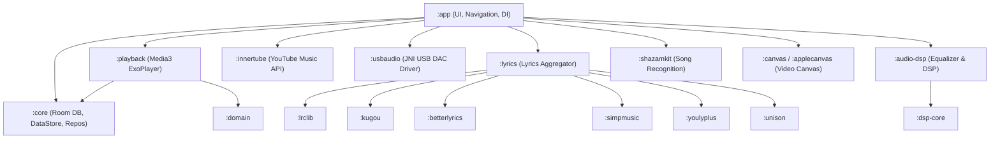

<p align="center">
  
</p>

<h1 align="center">Neko Music</h1>

<p align="center">
  A sleek, ad-free, open-source music streaming client for Android.<br>
  Built natively with <b>Kotlin</b> and <b>Jetpack Compose</b>, featuring audiophile Bit-Perfect USB DAC output, multi-source synced lyrics, and an immersive AMOLED design.
</p>

<p align="center">
  <a href="https://kotlinlang.org"></a>
  <a href="https://developer.android.com/jetpack/compose"></a>
  <a href="https://developer.android.com/media/media3"></a>
  <a href="LICENSE"></a>
</p>

<p align="center">
  <a href="#features">Features</a> &bull;
  <a href="#architecture">Architecture</a> &bull;
  <a href="SETUP.md">Setup &amp; Build</a> &bull;
  <a href="DESIGN.md">Design Guidelines</a> &bull;
  <a href="CONTRIBUTING.md">Contributing</a> &bull;
  <a href="CREDITS.md">Credits &amp; Lineage</a> &bull;
  <a href="PRIVACY_POLICY.md">Privacy Policy</a>
</p>

---

## Overview

**Neko Music** is an independent, feature-rich Android music streaming client designed around user autonomy, audio quality, and visual elegance.

Streaming directly from YouTube Music via the InnerTube API, Neko Music delivers uninterrupted, ad-free audio playback with zero background telemetry. The application is built using **Kotlin**, **Jetpack Compose (Material 3)**, and a modular **Clean Architecture**.

Neko Music is derived from **Echo Music**, with ancestral roots in **InnerTune** and **ViMusic**, incorporating Spotify integration from **Vivi Music**, widgets from **Metrolist**, and sovereign branding, infrastructure, and refinements maintained by [Purvesh Shinde](https://github.com/PurveshShinde).

---

## Features

### 🎧 Audio & Playback
- **Ad-Free Playback**: Direct audio streaming with no promotional audio injections or sponsored interruptions.
- **Bit-Perfect USB DAC Output**: Custom C++ JNI bridge and USB Host audio driver (`:usbaudio`) that bypasses the standard Android OS 48 kHz resampler.
- **Parametric Equalizer & DSP**: 10-band equalizer, bass boost, virtualizer, and loudness normalization (`:audio-dsp`, `:dsp-core`).
- **Gapless Playback & Crossfade**: Smooth track transitions with customizable duration.
- **AndroidX Media3 (ExoPlayer)**: Native background audio service, persistent notification controls, and lock-screen media sessions.
- **Offline Caching & Downloads**: Full offline song caching with local database export.

### 📝 Lyrics & Visuals
- **Multi-Source Synced Lyrics**: Aggregates time-synced lyrics from **LRCLIB**, **KuGou**, **BetterLyrics** (Apple/Spotify TTML syllable sync), **SimpMusic**, **PaxSenix**, **YouLyPlus**, and **Unison**.
- **AI Lyrics Translation**: Real-time translation of foreign lyrics using OpenRouter, DeepL, or Mistral AI (using user-provided API keys).
- **Dynamic Video Canvas**: Looping video backgrounds for supported tracks via Apple Music Canvas.
- **Song Recognition**: Quick audio recognition powered by ShazamKit (`:shazamkit`).

### 🎨 Design & Customization
- **True AMOLED Dark Mode**: Pitch-black interface (`#000000`) engineered for OLED battery savings.
- **Liquid Glass Aesthetic**: Glassmorphic blur sheets, squircle corner geometry, and fluid transition animations.
- **Dynamic Color (Monet)**: Theme and accent palettes dynamically adapt to active track artwork.
- **Home Screen Widgets**: Glance widgets including Modern Flow, Vintage Vinyl Turntable, Compact Glow, and Music Recognizer.

### 🌐 Integrations & Library
- **Spotify Integration**: Connect your Spotify account to browse, search, and mirror your private and public Spotify playlists directly into Neko Music.
- **Listen Together**: Synchronized group listening sessions over WebSockets with binary serialization.
- **Last.fm Scrobbling**: Real-time track scrobbling and now-playing updates.
- **Discord Rich Presence**: Live activity status on Discord displaying current track, artist, and playback state.
- **Local Media Support**: Index, organize, and play local audio files alongside streaming music.

---

## Architecture

Neko Music is structured across specialized Gradle modules:



| Module | Purpose |
| :--- | :--- |
| **`:app`** | Main entry point, Jetpack Compose UI screens, ViewModels, navigation, and dependency injection |
| **`:core`** | Room SQLite database (`InternalDatabase`), schema migrations, DataStore, and shared utilities |
| **`:domain`** | Pure Kotlin domain models, business logic interfaces, and contracts |
| **`:playback`** | Media3 ExoPlayer service (`MusicService`), notification callback, queue management, and downloads |
| **`:innertube`** | YouTube Music InnerTube client (stream resolution, search, playlists, albums, and artist info) |
| **`:lyrics`** | Synchronized lyrics engine with fallback chain across 7+ providers and AI translation |
| **`:usbaudio`** | Native C++ JNI bridge and USB Host driver for Bit-Perfect DAC output |
| **`:audio-dsp`** | Equalizer engine, parametric EQ, and digital signal processing |
| **`:shazamkit`** | Audio fingerprinting and song recognition via Shazam API |
| **`:canvas` / `:applecanvas`** | Animated video canvas playback engine and providers |
| **`:metadata`** | Metadata enrichment from Spotify, MusicBrainz, and Last.fm |

---

## Documentation

Comprehensive project documentation:

| Document | Description |
| :--- | :--- |
| **[SETUP.md](SETUP.md)** | Prerequisites, SDK/NDK configuration, Android Studio setup, and Gradle build commands |
| **[DESIGN.md](DESIGN.md)** | Jetpack Compose styling, Material 3 theming, Liquid Glass surfaces, and color tokens |
| **[CONTRIBUTING.md](CONTRIBUTING.md)** | Contribution workflow, coding style, licensing rules, and pull request guidelines |
| **[CREDITS.md](CREDITS.md)** | Upstream project lineage, copyright notices, and third-party acknowledgements |
| **[CHANGELOG.md](CHANGELOG.md)** | Chronological history of release changes and version milestones |
| **[PRIVACY_POLICY.md](PRIVACY_POLICY.md)** | Data handling policies, zero-telemetry guarantee, and local database security |
| **[SECURITY.md](SECURITY.md)** | Security disclosure policy and vulnerability reporting process |
| **[CODE_OF_CONDUCT.md](CODE_OF_CONDUCT.md)** | Contributor Covenant community behavioral standards |
| **[LICENSE](LICENSE)** | Complete GNU General Public License v3.0 legal terms |

---

## Quick Start

### Prerequisites
- **Android Studio** (Ladybug | 2024.2.1 or newer recommended)
- **JDK 21** (Eclipse Adoptium Temurin 21 or Android Studio embedded JDK)
- **Android SDK** (API 36 / 37, Build Tools 36.x, NDK `28.2.13676358`)

### Building from Source

```bash
# 1. Clone the repository
git clone https://github.com/PurveshShinde/Neko-Music.git
cd Neko-Music

# 2. Build FOSS Debug variant (100% open-source, no proprietary Google services)
./gradlew assembleArm64FossDebug

# Or on Windows PowerShell:
.\gradlew.bat assembleArm64FossDebug
```

For release signing, Google Services configuration, and flavor options (`foss` vs `gms`), refer to **[SETUP.md](SETUP.md)**.

---

## Lineage & Upstream Acknowledgements

Neko Music is proudly open-source and builds upon the dedication of the open-source Android music community:

- **Echo Music** ([EchoMusicApp/Echo-Music](https://github.com/EchoMusicApp/Echo-Music)): Immediate upstream project by Aditya ([@iad1tya](https://github.com/iad1tya)) and contributors (GPL-3.0).
- **InnerTune** ([z-huang/InnerTune](https://github.com/z-huang/InnerTune)): Foundational architecture and InnerTube client by Zion Huang (GPL-3.0).
- **ViMusic** ([vfsfitvnm/ViMusic](https://github.com/vfsfitvnm/ViMusic)): Pioneer open-source YouTube Music client by vfsfitvnm (GPL-3.0).
- **Spotify Integration**: Spotube/Vivi Music reverse-engineered Spotify authentication and session mapper by Chartreux Westia (`© Chartreux Westia — github.com/koiverse`, GPL-3.0).
- **Lossless Extension**: Audio addon provider by Silly Kat ([EchoMusicApp/lossless-extension](https://github.com/EchoMusicApp/lossless-extension), GPL-3.0).
- **Metrolist**: Glance widgets, ListenTogether concepts, and audio playback utilities (GPL-3.0).
- **Vendored Components**: `Kyant0/backdrop` (Apache 2.0) and `elyesmansour/compose-floating-tab-bar` (Apache 2.0).

For full details, copyright holders, and license texts, see **[CREDITS.md](CREDITS.md)**.

---

## Developer & Contact

- **Developer:** [Purvesh Shinde](https://github.com/PurveshShinde)
- **Website:** [purveshshinde.vercel.app](https://purveshshinde.vercel.app/)
- **Repository:** [https://github.com/PurveshShinde/Neko-Music](https://github.com/PurveshShinde/Neko-Music)

---

## License

Neko Music is licensed under the **GNU General Public License v3.0** ([GPL-3.0](LICENSE)).

```
Neko Music — An ad-free open-source music streaming client for Android.
Copyright (C) 2026 Purvesh Shinde and Neko Music Contributors.
Copyright (C) Echo Music, InnerTune, ViMusic, and Upstream Contributors.

This program is free software: you can redistribute it and/or modify
it under the terms of the GNU General Public License as published by
the Free Software Foundation, either version 3 of the License, or
(at your option) any later version.
```
